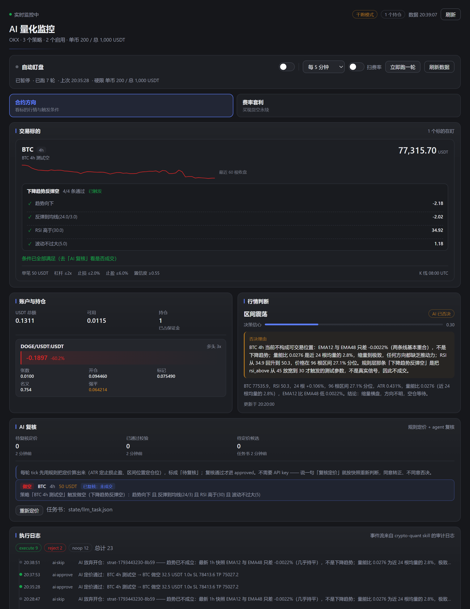

# OKXX — 加密货币量化交易研究框架

一套跑在本地、把**数据 → 规则 → 定价 → 风控 → 执行**拆开的分层系统，附带一个内嵌在 DSH 里的可视化监控面板。

不是印钞机。这个仓库里最诚实的东西是 **`okx_quant/reports/` 里的回测结果**，包括那些证明「这条路不通」的结论。

---

## 三个组成部分

| 目录 | 是什么 |
|---|---|
| `okx_quant/` | 核心：数据抓取、特征工程、信号规则、回测引擎、LLM 定价、执行层 |
| `quant-panel/` | DSH 插件：可视化面板（行情、触发条件对比、AI 复核、执行日志、策略管理） |
| `okx_trader/` | 早期 CLI 工具：下单、网格、TradingView webhook |
| `skills/crypto-quant/` | DSH skill：把整条链路编排成一个可定时执行的闭环 |

## 分层设计

```
patterns.py     这个位置值不值得动手？   纯规则，可回测
     ↓
strategy.py     仓位边界（单笔/杠杆/止损/止盈）
     ↓
llm_trade.py    具体买点、止损价、目标价   规则定价 + agent 复核 + 硬校验
     ↓
execute.py      下单（双开关：DRY_RUN + --live）
```

**关键约束：每一层都不能扩权。** 规则层说「可以开多」，定价层只能给更保守的仓位和止损；校验层过不了就整笔作废，不会"调一下数字再试"。

## 已经得出的结论（都是真实回测，不是估算）

### 方向择时：没有 alpha

- BTC 1h，42 个技术特征，walk-forward 5 折：AUC 0.5438，**十分位净收益全负**（-0.080% ~ -0.193%）
- 加入 22 个衍生品特征（资金费率/OI/多空比/爆仓）后 AUC 0.5214，但按年拆分：
  - 2024 **+1.239%** / 2025 **+0.367%** / 2026 **-0.481%**
  - 结论：整体正收益全靠 2024 牛市，是 beta 不是 alpha
- 实际回测：只做多 146 笔胜率 55.5%，总 **-11.25%**，回撤 **-43.8%** —— 胜率过半仍然亏钱，手续费吃掉了优势

### 8 套信号模板：只有 1 套跨市场稳定

BTC/ETH/SOL × 1h/4h，48 组回测中前后半段都为正的只有 **6 组（12%）**，随机水平约 25%。

按模板跨市场汇总（`mean_avg_net / 前半段 / 后半段`）：

| 模板 | 逻辑 | 均值 | 前半 | 后半 | 稳定 |
|---|---|---|---|---|---|
| `trend_breakdown` | 下降趋势 + 跌破前低 + 放量 | +0.1195 | +0.1363 | +0.1044 | ✅ |
| `trend_breakout` | 上升趋势 + 突破前高 + 放量 | +0.1821 | -0.0414 | +0.3885 | 2/6 |
| `trend_pullback` | 上升趋势 + 回踩均线 | -0.0842 | — | — | ❌ |
| `mean_revert` | 超跌 + 布林下轨 + 影线反转 | -0.0985 | — | — | ❌ |
| `trend_bounce_short` | 下降趋势 + 反弹到均线 | -0.1946 | — | — | 0/6 |

**最像「正常做多」的 `trend_pullback` 是明确亏钱的。**

### 资金费率中性套利：真实但收益不高

26 个主流币，2024-01 ~ 2026-10，1x 杠杆：

| 组合 | 年化 | 夏普 | 最大回撤 |
|---|---|---|---|
| 全部等权 | +5.75% | 9.03 | -1.43% |
| Top10 2x | +16.10% | 9.82 | -1.16% |
| 中位10 2x（剔除极端） | +14.44% | **11.61** | **-0.47%** |

⚠️ **这些夏普是虚高的**：回测把资金费率当无风险现金流，没建模基差风险（实测基差 std 0.097%，极端 +2.10% / -1.60%）、没算保证金占用和爆仓风险。打折后诚实预期：**年化 10~15%，夏普 2.5~4，回撤 3~8%**。

⚠️ **不要择时**：给费率策略加「负费率就撤出」的规则，384 次换手把 +21% 打成 **-41.56%**。

---

## 快速开始

### 环境

```
Python 3.13（numpy / pandas / lightgbm / ccxt）
Node 22+（只为面板插件）
Windows（脚本按 PowerShell 写；Python 部分是跨平台的）
```

### 只跑研究，不碰交易所

```bash
cd okx_quant
python datafeed.py 4h            # 拉 K 线到 data/
python patterns.py BTC 4h        # 看 8 套模板的触发次数与当前状态
python pattern_backtest.py --all # 跑完整回测，输出 reports/pattern_backtest.csv
python dashboard.py              # 生成 state/dashboard.json
```

不需要任何 API key。数据走 Gate.io 公开接口。

### 接交易所（默认干跑）

```powershell
# 用户级环境变量，脚本会自动读取
[Environment]::SetEnvironmentVariable("OKX_API_KEY", "...", "User")
[Environment]::SetEnvironmentVariable("OKX_API_SECRET", "...", "User")
[Environment]::SetEnvironmentVariable("OKX_API_PASSWORD", "...", "User")
[Environment]::SetEnvironmentVariable("PROXY", "http://127.0.0.1:7897", "User")
```

```bash
python verify_okx.py             # 只读六项自检：时间偏差、签名、账户模式、余额、持仓、市场元数据
python tick.py --skip-funding    # 跑一轮完整闭环（约 5 秒）
```

**`DRY_RUN=1` 是默认值。** 真正下单需要 `DRY_RUN=0` **且** 显式传 `--live`，双重开关是故意的。

### 面板

```bash
cd quant-panel
node --check client.js
# 挂到 DSH profile：见 README.md 的安装三步
```



---

## 这个仓库里最值得读的东西

1. **`okx_quant/patterns.py`** —— 24 个条件 + 8 套模板，每个条件都是纯函数，`scan_last()` 返回逐条 ✓/×
2. **`okx_quant/pattern_backtest.py`** —— 信号 t 根成立、t+1 根进场（不偷价）；同根内止损止盈都触及时按止损算；每笔扣 0.13% 往返成本；**把数据切前后两半分别回测**，两段都为正才算 stable
3. **`okx_quant/llm_trade.py`** —— `validate()` 里每一条校验都对应一类真实事故：方向错、买点偏离 2%、杠杆超限、多头止损设在买点上方（开仓即触发）
4. **`okx_quant/reports/`** —— 所有回测的原始输出，包括负结果

## 已知边界

- **数据源与交易源不同**：K 线取自 Gate.io，交易在 OKX。主流币价差 <0.1%，小币可能 1~2%，止损价会算歪
- **不做自动唤醒 LLM**：面板的定时器是纯 Node 进程，启动不了 agent 会话。定价用规则引擎算，标成「待复核」，由人或 agent 复核
- **滑点按固定 1.5bp 估**，没做盘口深度模拟
- **涨绿跌红是硬编码**，因为主题变量没有涨跌语义色

## 风险声明

加密货币合约交易会亏光本金。这个仓库提供的是**能安全表达判断的框架**，不是**已经验证能赚钱的策略**。上面的回测数字里，亏钱的那些才是重点。

自行承担全部风险。
